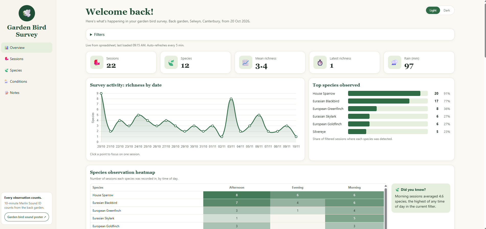

# Garden Bird Survey Dashboard
 
An interactive dashboard for a 30-day garden bird survey in Selwyn, Canterbury, New Zealand. Each day I record a 10-minute count with the Merlin Bird ID app (Sound ID), log the weather and background noise, and the dashboard turns the results into charts you can filter.
 
**Live dashboard:** https://mvanenter.github.io/garden-birds/
 

 
## What it shows
 
- **Summary cards:** sessions, species recorded, mean richness, latest richness and total rain
- **Survey activity:** species richness for each session, with click-to-focus on a single day
- **Top species:** share of sessions where each species was detected
- **Species heatmap:** how often each species was recorded in each time-of-day bin
- **Conditions:** richness against start hour, wind speed and rain, plus a full table of session conditions
- **Species by session grid:** a presence matrix for every species and date
- **Species guide:** photo cards with scientific name, family and NZ status. Click a card to filter the whole dashboard to that species
- **Filters:** time of day, noise, wind, wind direction, rain, rain chance, species and session date
- **Light and dark themes**, and a layout that works on phones

  
There is also a [garden bird sound poster](poster.html) that goes with the survey.
 
## Method
 
- **Start date:** 20 October 2026, collected daily for 30 days
- **Location:** back garden, suburban Selwyn, Canterbury
- **Count:** one 10-minute session per day, recorded with Merlin Sound ID
- **Recorded per session:** date, birds detected, time of day, start and end time, temperature, wind speed and direction, weather, cloud cover, rain, humidity, background noise and notes
- **Weather:** taken from a local weather app at the time of each count
  
## How it works
 
1. Sessions are entered in a Google Sheet that is published to the web as CSV.
2. The page fetches that CSV when it loads, and again every 5 minutes, so new rows appear without any code changes.
3. The data is cleaned in the browser: species names are standardised (for example "Common Redpoll" becomes "Redpoll"), blank rows are skipped, and missing weather values are treated as "Not recorded".
4. Charts are drawn with [Chart.js](https://www.chartjs.org/). The heatmap, tables and cards are plain HTML and CSS.
Everything is a single `index.html` file with no build step, hosted on GitHub Pages.
 
## Data columns
 
| Column | Description |
| --- | --- |
| `Session_ID` | Session number, for example S001 |
| `Date` | Day/month/year |
| `Birds_Recorded` | Species detected in the 10-minute count |
| `Time_of_Day` | Early morning, Mid-morning, Late morning, Midday, Afternoon or Evening |
| `Start_Time`, `End_Time` | Count start and end time |
| `Temperature_C`, `Humidity_Pct`, `Cloud_Cover_Pct` | Weather at the time of the count |
| `Wind_Kmh`, `Wind_Direction` | Wind speed and compass direction |
| `Rain_mm`, `Rain_Chance_Pct` | Rainfall and forecast chance of rain |
| `Weather_Condition` | Short description, for example Sunny |
| `Background_Noise` | Low, Medium or High |
| `Notes` | Noise sources, incidental sightings, Merlin difficulties |
 
## Limitations
 
- Merlin Sound ID detections are treated as identification records, not independently verified presence.
- Each session is a single 10-minute count at one spot, so this is not continuous monitoring.
- Species detected outside the 10-minute window (such as a Cirl Bunting on 24 October) are listed separately and kept out of richness calculations.
- With one garden and about 30 sessions, patterns are descriptive and should not be read as statistically conclusive.
## Run it locally
 
Browsers often block data requests from pages opened straight from disk, so use a small local server:
 
```bash
python -m http.server 8000
```
 
Then open http://localhost:8000/.
 
## Built with
 
HTML, CSS and vanilla JavaScript, Chart.js, Google Sheets, GitHub Pages, and the Wikipedia and Wikimedia Commons APIs for bird photos.
 
## Credits
 
- Bird identification records are based on Merlin Sound ID detections (Cornell Lab of Ornithology).
- Bird photographs retain their respective author credits and licences. Credits are shown on each species card and on Wikimedia Commons.
## Author
 
Melanie van Enter, GIS and geospatial specialist, Canterbury, New Zealand.
 
&copy; 2026 Melanie van Enter. All rights reserved.
 
